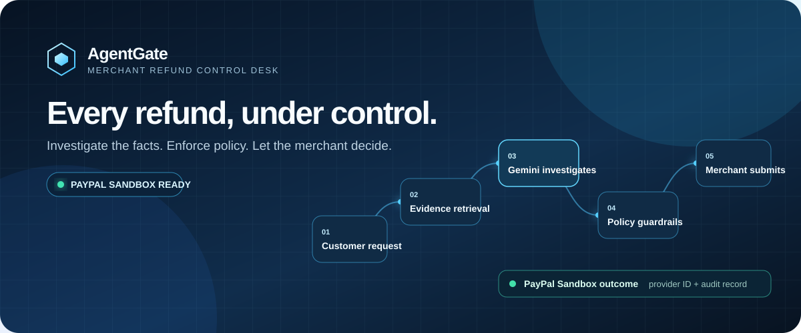
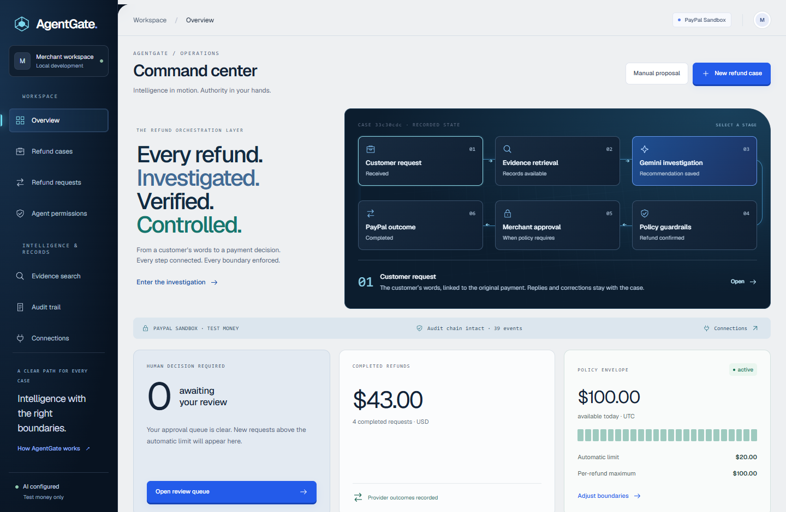
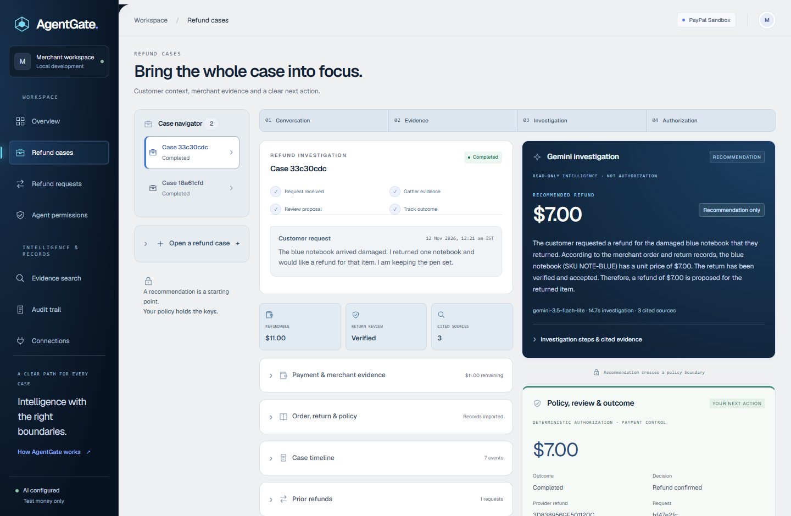
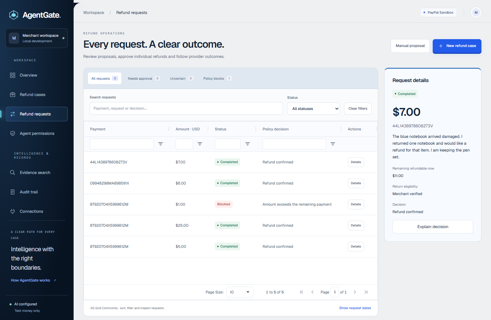
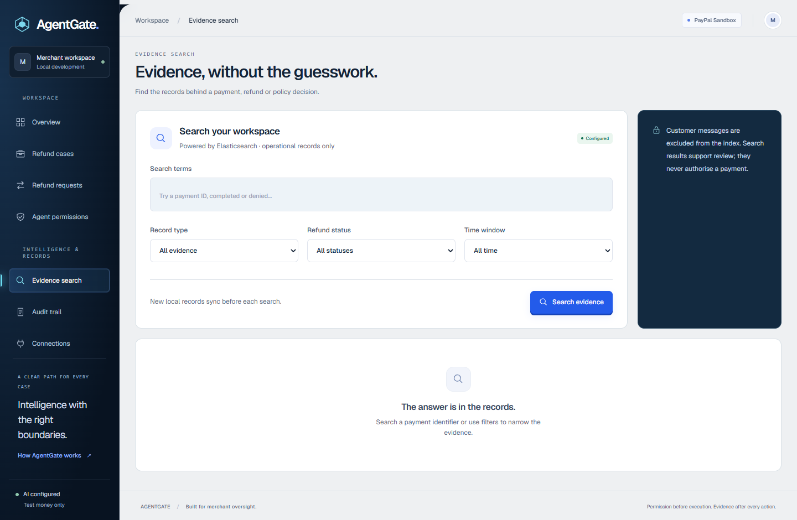
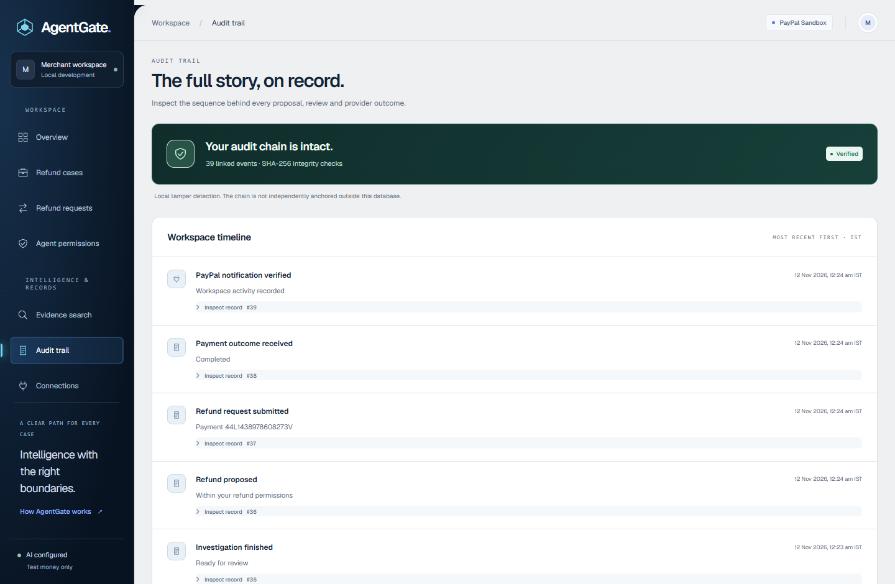

<p align="center">
  <a href="https://nodejs.org/"></a>
  
  
  
  
  
  
</p>

<p align="center">
  <strong>AI-assisted refund investigation for merchants.</strong><br>
  Customer context, merchant evidence, deterministic controls, and a PayPal Sandbox outcome—kept in one local workspace.
</p>

<p align="center">
  <a href="#run-locally">Run locally</a> ·
  <a href="#the-refund-workflow">See the workflow</a> ·
  <a href="#sponsor-integrations">Sponsor integrations</a> ·
  <a href="#sandbox-verification">Sandbox verification</a> ·
  <a href="docs/CASE_WORKFLOW.md">Case controls</a>
</p>

> **AI recommends. Policy decides. The merchant submits.**
>
> AgentGate is a local-first PayPal AI Hackathon prototype. It uses PayPal **Sandbox test money only** and is not affiliated with or endorsed by PayPal.

## Why

A refund is not just a payment action. A merchant needs the customer’s request, relevant order and return evidence, a clear policy decision, and a record of exactly what happened.

AgentGate brings those concerns into a single reviewable flow. Gemini can investigate the evidence and prepare a cited recommendation, but it never gets authority to change eligibility, alter merchant limits, approve a request, or call PayPal. Deterministic code and the merchant remain in control.

## Run locally

### Demo mode — no credentials required

```powershell
git clone https://github.com/Tanmay1214/AgentGate.git
cd AgentGate
npm ci
Copy-Item .env.example .env
npm run dev
```

Open [http://localhost:4310](http://localhost:4310). The default `.env` uses `PAYPAL_ENV=demo`, so every payment outcome is simulated locally.

Try these built-in scenarios:

| Payment | What it demonstrates |
| --- | --- |
| `DEMO-1042` | A $12 refund that completes automatically within policy |
| `DEMO-1043` | A $45 refund that pauses for individual merchant approval |
| `DEMO-1045` | A refund blocked because merchant eligibility is unverified |

### PayPal Sandbox + live Gemini investigation

Switch the local `.env` to your own Sandbox credentials. Keep every value private and out of Git.

```dotenv
PAYPAL_ENV=sandbox
PAYPAL_CLIENT_ID=your_sandbox_client_id
PAYPAL_CLIENT_SECRET=your_sandbox_client_secret

# Optional: enables Gemini's evidence-backed investigation panel.
GEMINI_API_KEY=your_gemini_key
GEMINI_MODEL=gemini-3.5-flash-lite

# Optional: enables Elasticsearch evidence search.
ELASTICSEARCH_URL=https://your-elasticsearch-endpoint
ELASTICSEARCH_API_KEY=your_elasticsearch_api_key
```

Restart `npm run dev`, open **Connections**, create a test checkout, and approve it with a PayPal Sandbox Personal buyer. AgentGate captures the approved payment and makes it available for a refund case.

The application has no live-payment mode. Do not enter production PayPal credentials.

## The refund workflow

```text
Customer request
       │
       ▼
Merchant order + return evidence ──► Gemini investigation ──► cited recommendation
                                                       │
                                                       ▼
                                      deterministic policy checks
                                      • eligibility
                                      • returned-item value
                                      • refundable balance
                                      • merchant limits
                                                       │
                                                       ▼
                                           merchant submit / approval
                                                       │
                                                       ▼
                                         PayPal Sandbox provider outcome
                                                       │
                                                       ▼
                                            append-only local audit trail
```

### A recommendation is not authorization

| Component | Can do | Cannot do |
| --- | --- | --- |
| **Gemini investigator** | Read scoped payment, policy, return, refund-history and audit evidence; prepare a cited recommendation or clarification | Change policy, set eligibility, approve a request, execute a refund, access credentials |
| **Policy engine** | Recheck eligibility, item ceiling, remaining refundable balance, daily budget and merchant thresholds | Invent evidence or treat AI text as authorization |
| **Merchant** | Verify eligibility, review recommendation, submit or approve a refund | Bypass hard limits or repeat an idempotent operation as a new refund |
| **PayPal Sandbox** | Capture an approved test order and execute or report a test refund outcome | Provide production payment processing in this project |

## What is inside

| Workspace | Purpose |
| --- | --- |
| **Command center** | Shows the investigation-to-outcome orchestration and current operational state |
| **Refund cases** | Customer conversation, order/return evidence, Gemini investigation, policy decision, and final outcome in one workspace |
| **Refund requests** | AG Grid review queue for approvals, uncertain provider outcomes, blocked requests, filters, and request detail |
| **Agent permissions** | Merchant-controlled automatic threshold, daily allowance, per-refund maximum, and individual approval path |
| **Evidence search** | Optional Elasticsearch search over sanitized operational evidence with local-ledger citation validation |
| **Audit trail** | SHA-256 chained events, integrity check, provider outcome records, and verified webhook events |
| **Connections** | PayPal Sandbox checkout, Gemini status, Elasticsearch status, and local integration guidance |

## Product gallery

Real screens from the local AgentGate workspace using PayPal Sandbox test data. No screenshots are mocked, and no buyer credentials or API keys are shown.



<p align="center"><sub><strong>Command Center</strong> — the customer request, evidence, AI investigation, policy, approval, and provider-outcome path at a glance.</sub></p>

<table>
  <tr>
    <td width="50%"><br><sub><strong>Refund Cases</strong> — conversation, merchant evidence, cited Gemini recommendation, and deterministic policy outcome in one review surface.</sub></td>
    <td width="50%"><br><sub><strong>Refund Requests</strong> — AG Grid review queues, filters, request details, and individual merchant actions.</sub></td>
  </tr>
  <tr>
    <td width="50%"><br><sub><strong>Evidence Search</strong> — optional Elasticsearch retrieval over sanitized operational records.</sub></td>
    <td width="50%"><br><sub><strong>Audit Trail</strong> — hash-chained events, verified provider notifications, and a readable decision sequence.</sub></td>
  </tr>
</table>

## Sponsor integrations

These are implemented product integrations, not decorative logos or claims of eligibility for a particular prize track.

| Sponsor tool | Where it appears in AgentGate | What it adds |
| --- | --- | --- |
| **AG Grid Community** | **Refund requests** review workspace | Search, status queues, column filters, numeric sorting, pagination, and per-request Details / Approve / Reject / Check outcome actions. Amounts are not bulk-approved or editable from the grid. |
| **Postman** | `postman/` collections and repeatable demo validation | Separate Demo and Sandbox collections plus a local environment. `npm run test:postman` starts an isolated demo server and runs 19 requests with 33 assertions—without PayPal or Gemini credentials. |
| **Elasticsearch** | **Evidence search** and Gemini’s read-only evidence retrieval | An optional searchable projection of sanitized operational metadata. Gemini citations are checked against the local audit sequence and hash before they can appear in an investigation. SQLite remains the source of truth. |

AG Grid is bundled locally with no Enterprise key or external data service. Elasticsearch is strictly optional: no operational metadata is sent until a merchant explicitly searches or syncs evidence. Read the exact setup, scope, and verification notes in [Sponsor integrations](docs/SPONSOR_INTEGRATIONS.md).

## Evidence and policy controls

AgentGate fails closed when it cannot establish a safe action.

- Merchant eligibility is explicit; customer text never makes a payment eligible.
- Imported return records enforce returned-item value and quantity ceilings.
- Every provider action is reserved atomically before execution.
- A stable idempotency key prevents a retry from producing another refund.
- Approval rechecks current evidence, remaining balance, permissions, and budget.
- A timeout without a provider refund ID becomes an uncertain outcome; AgentGate does not retry it automatically.
- Gemini receives restricted operational facts, never PayPal credentials.
- Audit events are append-only and hash-chained. This detects local row modification, but is not an external immutable ledger.

Read the detailed implementation notes in [Case workflow](docs/CASE_WORKFLOW.md), [Order and return evidence](docs/ORDER_RETURN_WORKFLOW.md), and [AI reliability](docs/AI_RELIABILITY.md).

## Sandbox verification

The core provider path has been exercised using real PayPal Sandbox test money:

- approved checkout capture
- automatic and above-threshold merchant-approved refund paths
- duplicate-operation protection and over-refund blocking
- checkout-return recovery and persistent local records across restart
- genuine signed PayPal capture and refund webhooks

The exact dated verification report, scope, and limitations are in [Sandbox verification](docs/SANDBOX_VERIFICATION.md). Provider-pending, timeout, and rejection behavior is covered with automated fixtures rather than deliberately induced on PayPal.

## Platform integrations

| Integration | Used for | Setup |
| --- | --- | --- |
| **Google Gemini** | Read-only, evidence-backed refund investigation | Add `GEMINI_API_KEY`; see [AI reliability](docs/AI_RELIABILITY.md) |
| **PayPal Sandbox** | Test checkout, capture, refund execution, and signature-verified webhooks | Add Sandbox REST credentials; see [Sandbox verification](docs/SANDBOX_VERIFICATION.md) |
| **Elasticsearch** | Sanitized operational evidence retrieval | Add the two Elasticsearch variables; see [sponsor integration setup](docs/SPONSOR_INTEGRATIONS.md#elasticsearch-evidence-search) |
| **AG Grid Community** | Review-table filtering, sorting, pagination, and actions | Bundled locally—no key required |
| **Postman** | Repeatable local and Sandbox API collections | Import `postman/` or run `npm run test:postman` |

## Test it

```powershell
# Policy, accounting, AI guardrail, checkout and evidence tests
npm test

# Browser regression and accessibility checks (install Chromium once first)
npx playwright install chromium
npm run test:ui

# Optional: evaluate the configured Gemini model against synthetic cases.
# This does not call PayPal.
npm run eval:cases
```

The browser suite uses a disposable demo database and disabled provider credentials. The live AI evaluation is intentionally separate: it records provider failures and invalid outputs rather than turning them into refunds.

## Local webhook development

The merchant workspace stays on `localhost`. For a fresh, signed Sandbox webhook during local development, expose only the narrow webhook proxy—not the dashboard:

```powershell
node --env-file=.env scripts/webhook-proxy.mjs
# Point a temporary HTTPS tunnel at http://127.0.0.1:4311
node --env-file=.env scripts/register-webhook.mjs https://YOUR-TUNNEL.trycloudflare.com/api/webhook
```

The helper saves the Sandbox webhook ID to `.env` and verifies it by fetching it from PayPal. Temporary tunnel addresses change whenever restarted. See [sponsor integration setup](docs/SPONSOR_INTEGRATIONS.md) for the full walkthrough.

## Scope and limitations

AgentGate is a single-merchant, local-first hackathon prototype. It does not provide multi-user authentication, customer identity verification, ecommerce-return ingestion, a distributed worker queue, external audit anchoring, or production PayPal payments. External refunds made outside AgentGate are not yet fully imported into local capture balances.

That boundary is deliberate: the project demonstrates how an AI investigation can stay useful without being allowed to move money on its own.

## Project notes

- [UI redesign notes](docs/UI_REDESIGN.md)
- [Second UI iteration notes](docs/UI_ITERATION_2.md)
- [Sponsor integrations](docs/SPONSOR_INTEGRATIONS.md)
- [Postman collections](postman/)
- [Third-party notices](THIRD_PARTY_NOTICES.md)
